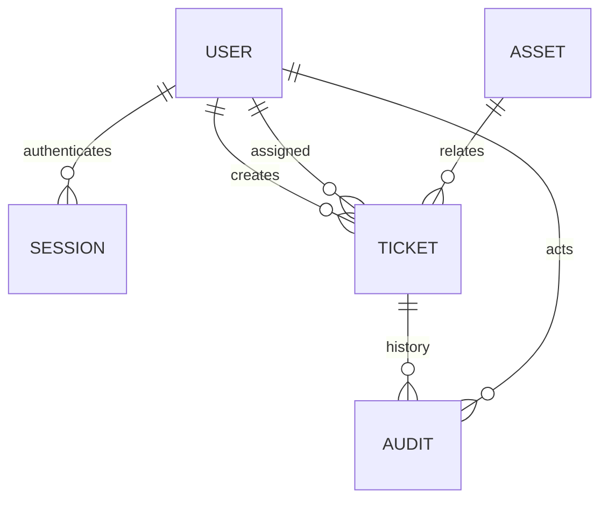

# 架构与接口设计

## 模块与数据
backend/workflowhub/db.py：引擎、会话和请求事务。models.py：用户/会话/资产/工单/审计；schemas.py：输入校验；security.py：密码和会话；services.py：权限、状态机、乐观锁、审计；各 routers 文件：HTTP 适配；main.py：异常与静态页面。独立 QA 项目只访问公开 HTTP 接口。

users.username 唯一；sessions.token_hash 主键；assets.code 与 tickets.number 唯一。tickets.creator_id、assignee_id、asset_id 及 audit.actor_id、ticket_id 外键。角色使用 users.role CHECK 约束，不做无用途的权限表。tickets.version 实施比较更新，SQL UPDATE WHERE id=:id AND version=:expected 返回 0 时 409。审计与更新同一 Session 提交；请求结束提交失败回滚。UTC 时间存无时区 datetime（约定 UTC）；响应时间加 Z。

## 接口合同
前缀 /api。所有写操作返回一致 JSON，删除会话 204。
|方法|路径|用途|
|---|---|---|
|GET|/health|数据库健康|
|POST|/auth/login|用户名密码换令牌|
|POST|/auth/logout|撤销当前令牌|
|GET|/auth/me|本人资料|
|GET,POST|/users|授权用户列表；管理员创建|
|GET,POST|/assets|资产分页；登记|
|PATCH|/assets/{id}|资产状态|
|GET,POST|/tickets|工单分页/筛选；幂等创建|
|GET|/tickets/stats|状态与负责人统计|
|GET,PATCH|/tickets/{id}|详情；版本编辑|
|POST|/tickets/{id}/assign|version、assignee_id|
|POST|/tickets/{id}/transition|version、target|
|POST|/tickets/{id}/notes|version、text|
|GET|/tickets/{id}/history|审计记录|

创建支持可选 Idempotency-Key，限制长度 8—64；按用户+key 唯一。相同 payload 返回原资源；异 payload 返回 409。两个同时创建触发唯一约束时回滚并返回 409，客户端可用相同 key 重试取得原资源。内容编辑与状态迁移不得绕过专用接口。请求模型 extra=forbid，禁止客户端改创建者/角色/状态。

## 查询与索引
复合索引 creator_id, created_at, id；assignee_id, created_at, id；status, created_at, id。过滤查询和 count 使用相同授权条件，避免统计泄漏。关键词 LIKE 使用绑定参数并转义 %/_，不接受 SQL 字符串。固定排序尾键 id 防止同时间戳顺序漂移；深 offset 仍有性能限制。scripts/benchmark.py 保存数据规模、SQL、EXPLAIN、前后索引和原始延迟；SQLite 与 MySQL 执行计划分开报告，不能相互代替。

## 测试边界
业务项目：状态机单元、httpx ASGI API/真实 SQLAlchemy 数据库集成、双线程真实版本冲突、审计故障注入回滚、Alembic upgrade/downgrade。QA：独立 httpx TCP 客户端，实际应用进程、角色矩阵、完整业务回归，生成 JUnit；集合通过 OpenAPI 生成。MySQL 专项在真实 MySQL 实例运行后才可标记通过。
